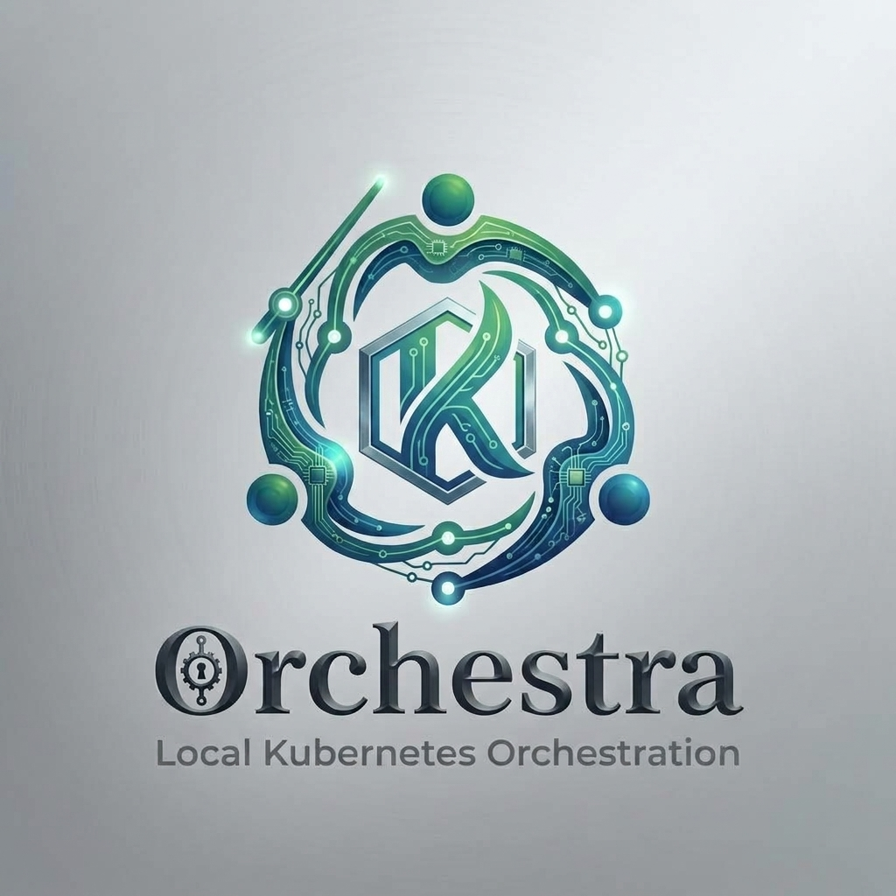

# Orchestra

<div align="center">



### High-Performance, eBPF-Powered Kubernetes Cluster Orchestration in Rust

[](https://github.com/msaeedb40/orchestra/actions/workflows/ci.yml)
[](https://github.com/msaeedb40/orchestra/actions/workflows/test.yml)
[](LICENSE)
[](https://www.rust-lang.org)
[](https://kubernetes.io)

</div>

---

**Orchestra** is a production-grade Kubernetes cluster orchestrator written in 100% safe, idiomatic Rust. It provisions and manages multi-node Kubernetes clusters inside Docker containers, accelerated by an in-kernel eBPF dataplane that replaces traditional `kube-proxy` with low-latency XDP/TC service load balancing.

---

## Key Features

- **Rust-First Architecture**: Zero garbage collection, predictable memory safety, and high-concurrency async I/O via Tokio and Tonic.
- **OrchestraNet — Native CNI**: Orchestra's own lightweight host-routing CNI. Zero tunneling overhead, minimal footprint, and full eBPF dataplane integration out of the box.
- **In-Kernel eBPF Service Dataplane**: Replaces `kube-proxy` with XDP and TC `clsact` hooks — 5-tuple connection-tracking and DNAT before the standard network stack.
- **Multi-Version Kubernetes Engine**: OCI node images with containerd, runc, systemd, and kubeadm across **v1.34 – v1.37**.
- **CNI Flexibility**: Conflict-free coexistence with **OrchestraNet** (default), **Flannel**, **Calico**, and **Cilium**.
- **Dynamic Subnet Allocation**: Automatically selects the first available `/16` block in `172.16–172.31` — no manual subnet configuration needed.
- **Hardened Container Security**: Seccomp-BPF profiles, cgroups v2 validation, namespace auditing, and gRPC RBAC.
- **Observability Built-In**: Prometheus metrics, OpenTelemetry tracing, real-time event streaming, and JSON diagnostics.
- **Enterprise Persistence**: SQLite with foreign-key cascades, operation journals, reconciliation checkpoints, and desired-state recovery.

---

## Architecture Overview

```
                           ┌───────────────────────┐
                           │     orchestra CLI     │
                           └───────────┬───────────┘
                                       │ gRPC / Unix Socket
                                       ▼
                           ┌───────────────────────┐
                           │   orchestrad Daemon   │
                           │  (Reconciliation Loop)│
                           └───────────┬───────────┘
                                       │
        ┌──────────────────────────────┼──────────────────────────────┐
        ▼                              ▼                              ▼
┌───────────────────┐        ┌───────────────────┐        ┌───────────────────┐
│ orchestra-runtime │        │ orchestra-k8s     │        │  orchestra-ebpf   │
│ (Docker Engine)   │        │ (kubeadm + CNI)   │        │ (XDP/TC Dataplane)│
└───────────────────┘        └───────────────────┘        └───────────────────┘
        │                              │                              │
        └──────────────────────────────┼──────────────────────────────┘
                                       ▼
                           ┌───────────────────────┐
                           │   orchestra-network   │
                           │ (OrchestraNet + IPAM) │
                           └───────────────────────┘
                                       │
                                       ▼
                           ┌───────────────────────┐
                           │   orchestra-storage   │
                           │   (SQLite Engine)     │
                           └───────────────────────┘
```

For full architectural details, see the [Architecture Documentation](docs/architecture/overview.md).

---

## Quickstart

### One-command setup

```bash
git clone https://github.com/msaeedb40/orchestra.git
cd orchestra

# Preflight check → build → install → start systemd service
./setup.sh
```

`setup.sh` validates your environment, compiles release binaries, installs them to `~/.local/bin`, and configures `orchestrad` as a systemd user service with automatic Docker socket detection (supports both standard Docker and Docker Desktop).

### Step-by-step

```bash
./setup.sh --check    # Validate system requirements
./setup.sh --deps     # Install system packages (needs sudo)
./setup.sh --build    # Build workspace + node images
./setup.sh --install  # Install binaries to ~/.local/bin
./setup.sh --daemon   # Configure & start orchestrad as systemd user service
```

### Verify

```bash
systemctl --user status orchestrad
orchestra system ping
# → OK: pong
```

---

## Provision a Kubernetes Cluster

```bash
# Create a cluster with OrchestraNet CNI + eBPF service proxy
orchestra cluster create my-cluster \
  --kubernetes-version v1.37.1 \
  --control-plane 1 \
  --workers 2 \
  --cni orchestranet \
  --proxy-mode orchestra

# Watch status
orchestra cluster get my-cluster

# List nodes
orchestra node list my-cluster

# Inspect eBPF dataplane
orchestra ebpf status
```

---

## Declarative Configuration

Clusters can be declared using standard YAML manifests:

```yaml
apiVersion: orchestra.io/v1alpha1
kind: Cluster
metadata:
  name: prod-cluster
spec:
  kubernetesVersion: v1.37.1
  nodes:
    controlPlane:
      count: 1
    workers:
      count: 3
  network:
    cni: orchestranet       # Orchestra's native CNI (default)
    podCidr: 10.244.0.0/16
    serviceCidr: 10.96.0.0/12
  proxy:
    mode: orchestra         # In-kernel XDP/TC eBPF service proxy
  ebpf:
    enabled: true
```

```bash
orchestra cluster create --config prod-cluster.yaml
```

See [Configuration Schema Reference](docs/configuration/schema.md) for all fields.

---

## CNI Options

| CNI | Mode | Best For |
|-----|------|----------|
| `orchestranet` *(default)* | Host routing | Dev & production — zero overhead, full eBPF integration |
| `flannel` | VXLAN overlay | Multi-host overlay networking |
| `calico` | BGP routing | Enterprise network policy |
| `cilium` | eBPF native | Native eBPF routing (use `--proxy-mode cni`) |
| `none` | BYO | Custom CNI deployments |

---

## Node Image Matrix

| Image Tag | Kubernetes Version |
|-----------|-------------------|
| `orchestra-node:1.37.1` | v1.37.1 |
| `orchestra-node:1.36.6` | v1.36.6 |
| `orchestra-node:1.35.9` | v1.35.9 |
| `orchestra-node:1.34.12` | v1.34.12 |

```bash
# Build all versions
./scripts/build-node-images.sh

# Build a specific version
./scripts/build-node-images.sh 1.37.1
```

---

## Deployment Options

### systemd user service (recommended for local dev)

```bash
./setup.sh --daemon
systemctl --user status orchestrad
journalctl --user -u orchestrad -f
```

### Docker Compose

```bash
# Standard Docker socket
docker compose -f deployments/docker/docker-compose.yml up -d

# Docker Desktop
docker compose -f deployments/docker/docker-compose.yml --profile docker-desktop up -d
```

### Helm (management Kubernetes cluster)

```bash
helm install orchestra deployments/kubernetes/orchestra/ \
  -n orchestra --create-namespace
kubectl -n orchestra port-forward svc/orchestra 50051:50051
```

See [Helm Deployment Guide](docs/user-guide/helm-deployment.md) for full configuration.

---

## Testing & Quality Assurance

```bash
# Run unit, integration, and E2E tests across the workspace
./scripts/test.sh

# Formatting and strict Clippy linting (both workspaces)
./scripts/lint.sh

# Run Criterion benchmarks
cargo bench -p orchestra-benchmarks -- --test

# Preflight environment check
./scripts/preflight.sh
```

---

## Documentation

| Guide | Description |
|-------|-------------|
| [Quickstart Guide](docs/user-guide/quickstart.md) | Build, install, create first cluster |
| [CLI Reference](docs/user-guide/cli-reference.md) | All commands, flags, and exit codes |
| [CNI Integration](docs/user-guide/cni-integration.md) | OrchestraNet, Flannel, Calico, Cilium |
| [Configuration Schema](docs/configuration/schema.md) | Full YAML/TOML field reference |
| [Helm Deployment](docs/user-guide/helm-deployment.md) | Deploy into an existing K8s cluster |
| [Developer Setup](docs/development/setup.md) | Build from source, testing, IDE setup |
| [Architecture Overview](docs/architecture/overview.md) | Crate hierarchy and subsystem design |
| [eBPF Dataplane](docs/architecture/ebpf-dataplane.md) | XDP/TC hooks, BPF maps, conntrack |
| [Security Model](docs/architecture/security-model.md) | Capabilities, seccomp, RBAC |

---

## License

Orchestra is licensed under the [Apache License, Version 2.0](LICENSE).
